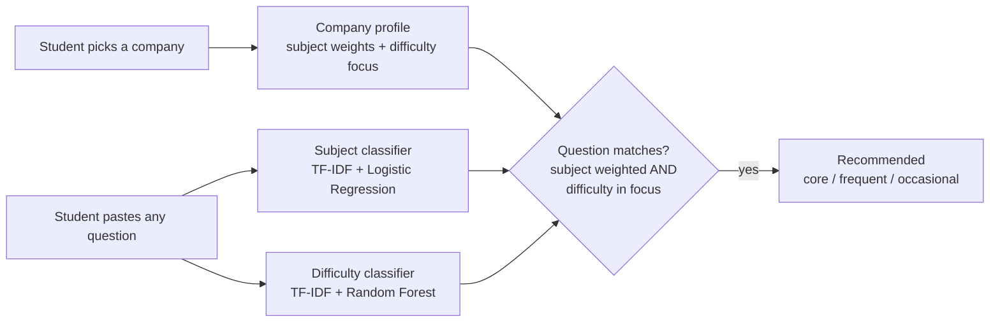
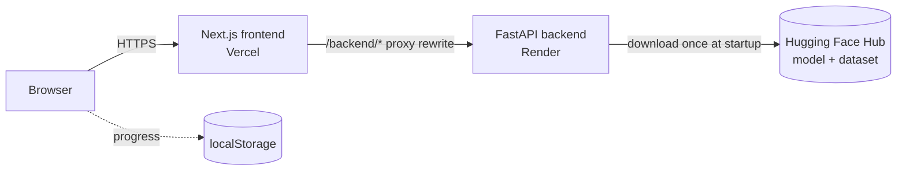

<div align="center">

# PrepMap

**Placement & interview prep, matched to the company you're targeting.**

Pick a company (TCS, Infosys, ZS Associates, Google, Amazon and 14 more), get practice questions matched to its public hiring process, and paste any question to have an ML model predict its subject, difficulty and the companies it's recommended for.

[](https://prepmap-three.vercel.app)
[](https://prep-map.onrender.com/docs)

[](https://huggingface.co/datasets/adithegod/asked_before_cs_interview_questions)
[](https://huggingface.co/adithegod/prepmap_question_classifier)


</div>

> **Honesty note.** Company labels mean **"recommended for"**, based on each company's *public* hiring process.
> PrepMap never claims a question was "asked by" or is a "previous year question" from any company.
> *Recommended based on each company's public hiring process, not a record of questions the company asked.*

---

## Contents

- [Live links](#live-links)
- [What PrepMap does](#what-prepmap-does)
- [How it works](#how-it-works)
- [The dataset (made by me)](#the-dataset-made-by-me)
- [Company profiles](#company-profiles)
- [The ML models](#the-ml-models)
- [Architecture](#architecture)
- [Tech stack](#tech-stack)
- [API reference](#api-reference)
- [Frontend](#frontend)
- [Repository structure](#repository-structure)
- [Run it locally](#run-it-locally)
- [Deployment](#deployment)
- [Environment variables](#environment-variables)
- [Limitations](#limitations)
- [Roadmap](#roadmap)
- [License & credits](#license--credits)

---

## Live links

| What | Link |
| --- | --- |
| **Website** (Vercel) | https://prepmap-three.vercel.app |
| **Backend API** (Render) | https://prep-map.onrender.com |
| **Interactive API docs** (Swagger) | https://prep-map.onrender.com/docs |
| **Health check** | https://prep-map.onrender.com/health |
| **Dataset** (made by me) | https://huggingface.co/datasets/adithegod/asked_before_cs_interview_questions |
| **Model** (trained by me) | https://huggingface.co/adithegod/prepmap_question_classifier |
| **Source code** | https://github.com/AdityasagarR123/PREP_MAP |

> The API runs on Render's free tier, which sleeps when idle. The **first request after a quiet period can take up to
> a minute** — the website shows a "Waking up the server…" message and retries automatically.

---

## What PrepMap does

| Feature | Description |
| --- | --- |
| **Company-matched practice** | Choose one of 19 companies and get a practice set ordered core → frequent → occasional for that company's process. |
| **Filters & shareable sets** | Filter by subject, relevance and difficulty, choose 5–100 questions. Filters and a random seed live in the URL, so the same link always gives the same set. |
| **Practice mode** | One question at a time with Previous / Next, keyboard shortcuts and an end-of-set summary of subjects covered. |
| **Question analyser** | Paste any question (3–500 characters). The model predicts its subject (with top-3 probabilities) and difficulty, then lists the companies it's recommended for. |
| **Company profiles** | Fresher roles, hiring rounds, subject tiers, difficulty focus, data confidence and a link to the public source. |
| **My progress** | Mark questions *Practised* or *Revise later*, set a target company, and see coverage by subject and difficulty. Stored only in your browser — no login. |
| **3D company map** | An interactive, drag-to-spin globe of all 19 companies plus floating 3D UI cards (pure canvas + CSS, no 3D library). |

> There are **no model answers** in the dataset, so PrepMap never shows or invents answers.

---

## How it works



Each company profile gives subjects a weight — **core = 3, frequent = 2, occasional = 1** — plus a **difficulty
focus** (e.g. `easy/medium` for mass recruiters, `medium/hard` for Big Tech). A question is recommended for a
company when its subject has a weight in that profile **and** its difficulty is in the company's focus. The weight
becomes the question's relevance for that company.

---

## The dataset (made by me)

**[adithegod/asked_before_cs_interview_questions](https://huggingface.co/datasets/adithegod/asked_before_cs_interview_questions)** · License: CC BY 4.0

- **1,770 original questions**, written for this project — not copied from any website or question bank.
- **15 subjects**, each question labelled with a subject and a difficulty (easy / medium / hard).
- **Per-company relevance** columns for all 19 companies (`core`, `frequent`, `occasional` or blank).
- File: `askedbefore_cs_interview_questions.csv`

<details>
<summary><b>The 15 subjects</b></summary>

| Technical | Aptitude & reasoning | Other |
| --- | --- | --- |
| DSA | Quantitative Aptitude | Behavioral / HR |
| Operating Systems | Logical Reasoning | Guesstimates & Case Studies |
| DBMS & SQL | Verbal Ability | Statistics & Analytics |
| Computer Networks | | Machine Learning |
| OOP | | Cloud & Security |
| System Design | | |
| Programming Fundamentals | | |

</details>

---

## Company profiles

19 profiles built from **public hiring-process information** (test patterns, interview rounds, fresher roles).
Every profile links its public source.

| Company | Category | Core subjects | Difficulty focus | Data confidence |
| --- | --- | --- | --- | --- |
| TCS | IT services (mass recruiter) | Logical Reasoning, Programming Fundamentals, Quantitative Aptitude, Verbal Ability | easy, medium | medium |
| Infosys | IT services (mass recruiter) | DBMS & SQL, DSA, OOP | easy, medium, hard | medium |
| Wipro | IT services (mass recruiter) | Logical Reasoning, Programming Fundamentals, Quantitative Aptitude, Verbal Ability | easy, medium | medium |
| Accenture | IT services (mass recruiter) | Cloud & Security, Logical Reasoning, Programming Fundamentals, Verbal Ability | easy, medium | medium |
| Cognizant | IT services (mass recruiter) | DBMS & SQL, Logical Reasoning, Programming Fundamentals, Quantitative Aptitude, Verbal Ability | easy, medium | medium |
| Capgemini | IT services (mass recruiter) | Behavioral / HR, Logical Reasoning, Programming Fundamentals | easy, medium | medium |
| HCLTech | IT services (mass recruiter) | Logical Reasoning, Quantitative Aptitude | easy, medium | medium |
| Deloitte | Consulting and technology services | Cloud & Security | easy, medium | medium |
| ZS Associates | Consulting and analytics | Behavioral / HR, DBMS & SQL, Guesstimates & Case Studies, Statistics & Analytics | easy, medium, hard | medium |
| ION Group | Fintech and trading software | DSA, OOP, Operating Systems, Programming Fundamentals | easy, medium, hard | medium |
| Oracle | Enterprise software | DBMS & SQL, DSA | easy, medium, hard | medium |
| Adobe | Product company | DSA | medium, hard | medium |
| Blinkit | Product company (Indian startup) | DSA | medium, hard | **low** |
| Google | Big Tech | DSA | medium, hard | medium |
| Microsoft | Big Tech | DSA | medium, hard | medium |
| Amazon | Big Tech | Behavioral / HR, DSA | medium, hard | high |
| Meta | Big Tech | Behavioral / HR, DSA | medium, hard | medium |
| Apple | Big Tech | Behavioral / HR | medium, hard | medium |
| Netflix | Big Tech | Behavioral / HR, System Design | medium, hard | medium |

Frequent and occasional subjects, hiring rounds and sources for each company are on its page on the website and in
`GET /companies/{name}`.

---

## The ML models

**[adithegod/prepmap_question_classifier](https://huggingface.co/adithegod/prepmap_question_classifier)** · License: CC BY 4.0

Two scikit-learn pipelines, trained on the 1,770 questions. Three model families were compared for each task using
**macro F1 from stratified 5-fold cross-validation**:

| Model | Subject (15 classes) | Difficulty (3 classes) |
| --- | ---: | ---: |
| Random Forest (baseline) | 0.628 | **0.564** (used) |
| Logistic Regression | **0.762** (used) | 0.520 |
| XGBoost | 0.603 | 0.510 |

- **Subject classifier (used):** TF-IDF on word 1–2-grams + character 3–5-grams → Logistic Regression.
- **Difficulty classifier (used):** TF-IDF → Random Forest (500 trees).
- Difficulty is noticeably harder to predict than subject, so the website labels difficulty predictions as approximate.

| File in the model repo | Purpose |
| --- | --- |
| `subject_model.joblib` | Subject pipeline (vectoriser + classifier) |
| `difficulty_model.joblib` | Difficulty pipeline |
| `subject_label_encoder.joblib` / `difficulty_label_encoder.joblib` | Map class IDs ↔ labels |
| `company_rules.json` | Per-company subject weights (3/2/1) and difficulty focus |
| `results.json` | Cross-validation scores for all compared models |

---

## Architecture



- The **backend** downloads the models, `company_rules.json`, the questions CSV and company profiles from Hugging
  Face **once at startup**, keeps them in memory and serves everything from RAM.
- The **frontend** never calls Render directly from the browser. It calls `/backend/*` on its own domain and
  `next.config.ts` proxies those requests to the API — so no CORS configuration is needed.
- **No database and no login.** Student progress lives in the browser's `localStorage`.

---

## Tech stack

| Layer | Technology |
| --- | --- |
| Frontend | Next.js 15 (App Router), React 19, TypeScript, plain CSS, Instrument Sans (`next/font`) |
| 3D / motion | Hand-written `<canvas>` globe, CSS 3D transforms — no UI or 3D libraries |
| Backend | FastAPI, Pydantic v2, Uvicorn |
| ML | scikit-learn 1.6.1, pandas, NumPy, joblib |
| Model & data hosting | Hugging Face Hub |
| Hosting | Vercel (frontend), Render free tier (backend) |

---

## API reference

Base URL: **`https://prep-map.onrender.com`** · Full interactive docs: **[/docs](https://prep-map.onrender.com/docs)**

| Method | Endpoint | Description |
| --- | --- | --- |
| `GET` | `/health` | Status plus counts: `{status, models_loaded, questions, companies, subjects}` |
| `GET` | `/subjects` | The 15 subjects |
| `GET` | `/companies` | All 19 company profiles |
| `GET` | `/companies/{name}` | One profile + question counts by relevance and by subject (case-insensitive, URL-encode spaces) |
| `GET` | `/practice` | Practice set — `company` (required), `subject`, `relevance`, `difficulty` (default `All`), `n` (1–100, default 20), `seed` |
| `GET` | `/questions/{id}` | One question with every company it's recommended for |
| `POST` | `/analyse` | Body `{"question": "..."}` (3–500 chars) → subject, confidence, top-3 candidates, difficulty, `recommended_for` |

<details>
<summary><b>Example: analyse a question</b></summary>

```bash
curl -X POST https://prep-map.onrender.com/analyse \
  -H "Content-Type: application/json" \
  -d '{"question": "What is a deadlock in operating systems and what conditions cause it?"}'
```

```json
{
  "question": "What is a deadlock in operating systems and what conditions cause it?",
  "subject": "Operating Systems",
  "subject_confidence": 0.9824,
  "subject_candidates": [
    {"subject": "Operating Systems", "probability": 0.9824},
    {"subject": "DBMS & SQL", "probability": 0.0046},
    {"subject": "System Design", "probability": 0.003}
  ],
  "difficulty": "medium",
  "recommended_for": [
    {"company": "ION Group", "relevance": "core"},
    {"company": "Adobe", "relevance": "frequent"},
    {"company": "HCLTech", "relevance": "frequent"},
    {"company": "Microsoft", "relevance": "frequent"}
  ],
  "disclaimer": "Recommended based on each company's public hiring process, not a record of questions the company asked."
}
```
*(Real output from the live API; `recommended_for` trimmed to the first 4 of 10 companies.)*
</details>

<details>
<summary><b>Example: a reproducible practice set</b></summary>

```bash
curl "https://prep-map.onrender.com/practice?company=ZS%20Associates&difficulty=medium&n=5&seed=42"
```

Questions are shuffled with the seed and then ordered core → frequent → occasional, so the same parameters always
return the same set.
</details>

More examples (every endpoint with full responses) are in [`backend/README.md`](backend/README.md).

---

## Frontend

| Route | Page |
| --- | --- |
| `/` | Hero with floating 3D widgets (live practice set, analyser example, your progress), company marquee, feature showcase, 3D globe, FAQ |
| `/companies` | All companies — filter by category, search by name |
| `/company/[name]` | Hiring profile, question counts, practice set with URL-synced filters and **New set** |
| `/company/[name]/practice` | Practice mode — one question at a time, progress count, summary at the end |
| `/analyse` | Question analyser with validation and clickable examples |
| `/question/[id]` | One question, its subject/difficulty and every recommended company — shareable |
| `/progress` | Target company, totals, breakdowns, core-subject coverage, revise-later list, reset |
| `/about` | Data, mapping, model scores, limitations, links |

Quality details: loading / empty / error states on every API call, cold-start wake-up with retry and backoff,
session caching of `/companies` and `/subjects`, per-page titles and meta descriptions, keyboard accessible,
labelled form controls, `prefers-reduced-motion` support, and responsive layouts down to phone width.

See [`frontend/README.md`](frontend/README.md) for more.

---

## Repository structure

```
PREP_MAP/
├── backend/                  # FastAPI API (deployed on Render)
│   ├── main.py               # routes: /health /subjects /companies /practice /questions /analyse
│   ├── loader.py             # downloads + loads models and data from Hugging Face at startup
│   ├── schemas.py            # Pydantic request/response models
│   ├── test_api.py           # pytest suite
│   ├── requirements.txt
│   └── README.md             # full API docs with example responses
├── frontend/                 # Next.js app (deployed on Vercel)
│   ├── app/                  # pages (App Router) + globals.css design system
│   ├── components/           # Header, Footer, HeroStack, Orb (3D globe), Tilt, Badges, ...
│   ├── lib/                  # api.ts (typed API client), progress.ts (localStorage), ...
│   ├── next.config.ts        # /backend/* → API proxy
│   ├── .env.example
│   └── README.md
├── render.yaml               # Render blueprint for the backend
└── README.md                 # you are here
```

---

## Run it locally

**Prerequisites:** Python 3.11, Node.js 20+ (22 LTS recommended), Git.

```bash
git clone https://github.com/AdityasagarR123/PREP_MAP.git
cd PREP_MAP
```

### 1. Backend (http://localhost:8000)

```bash
cd backend
python -m venv .venv
# Windows: .venv\Scripts\activate    macOS/Linux: source .venv/bin/activate
pip install -r requirements.txt
uvicorn main:app --reload --port 8000
```

The first start downloads the models and data from Hugging Face. Open http://localhost:8000/docs to try the API.
Run the tests with `pytest test_api.py -v`.

### 2. Frontend (http://localhost:3000)

```bash
cd frontend
npm install
cp .env.example .env.local      # NEXT_PUBLIC_API_URL=http://localhost:8000
npm run dev
```

To use the deployed API instead of a local one, set `NEXT_PUBLIC_API_URL=https://prep-map.onrender.com` in
`.env.local` and restart `npm run dev`.

---

## Deployment

### Backend → Render

1. **New → Web Service** (or **Blueprint** using `render.yaml`) and connect this repo.
2. **Root Directory:** `backend`
3. **Build command:** `pip install -r requirements.txt`
4. **Start command:** `uvicorn main:app --host 0.0.0.0 --port $PORT`
5. Set `PYTHON_VERSION=3.11.9` and the other variables below, then deploy. Check `/health`.

### Frontend → Vercel

1. **Add New → Project** and import this repo.
2. **Root Directory:** `frontend` (Next.js is detected automatically).
3. **Environment variable:** `NEXT_PUBLIC_API_URL = https://prep-map.onrender.com` (no trailing slash).
4. Deploy. Every push to `main` redeploys automatically.

Because the frontend proxies API calls through `/backend/*`, you **don't** need to add the Vercel domain to the
backend's `ALLOWED_ORIGINS`.

---

## Environment variables

| Variable | Where | Example | Purpose |
| --- | --- | --- | --- |
| `NEXT_PUBLIC_API_URL` | Vercel / `frontend/.env.local` | `https://prep-map.onrender.com` | Backend URL the frontend proxies to (built in at build time — redeploy after changing) |
| `PYTHON_VERSION` | Render | `3.11.9` | Python runtime (keeps joblib files compatible with scikit-learn 1.6.1) |
| `MODEL_REPO` | Render | `adithegod/prepmap_question_classifier` | Hugging Face model repo |
| `DATASET_REPO` | Render | `adithegod/asked_before_cs_interview_questions` | Hugging Face dataset repo |
| `ALLOWED_ORIGINS` | Render | `*` | CORS origins for direct API access (comma-separated) |
| `HF_HOME` | Render | `/opt/render/project/src/.hf_cache` | Cache folder for Hugging Face downloads |
| `LOCAL_ARTIFACTS` | local (optional) | `/path/to/artifacts` | Load models/data from a local folder instead of Hugging Face |

---

## Limitations

- **Recommended, not reported.** Company mappings come from public hiring-process information. They are a study
  guide, not a record of what any company asked.
- **No answers yet.** The dataset contains questions only.
- **Difficulty is approximate.** Both the labels and the difficulty classifier (macro F1 0.564) are rough guides.
- **Blinkit has low confidence.** Its profile is based on very little public information.
- **Cold starts.** The free Render instance sleeps when idle; the first request can take up to a minute.

---

## Roadmap

- [ ] **Share your interview experience** — a form to collect real interview reports to make profiles more
      accurate (placeholder on the About page)
- [ ] Model answers / hints for questions
- [ ] More companies and more questions per subject
- [ ] Better difficulty prediction

---

## License & credits

- **Dataset** and **model**: created by me, released under **CC BY 4.0** on Hugging Face.
- **Code**: this repository.
- Built by **[AdityasagarR123](https://github.com/AdityasagarR123)**.

If PrepMap helped your prep, a star on the repo is appreciated!
